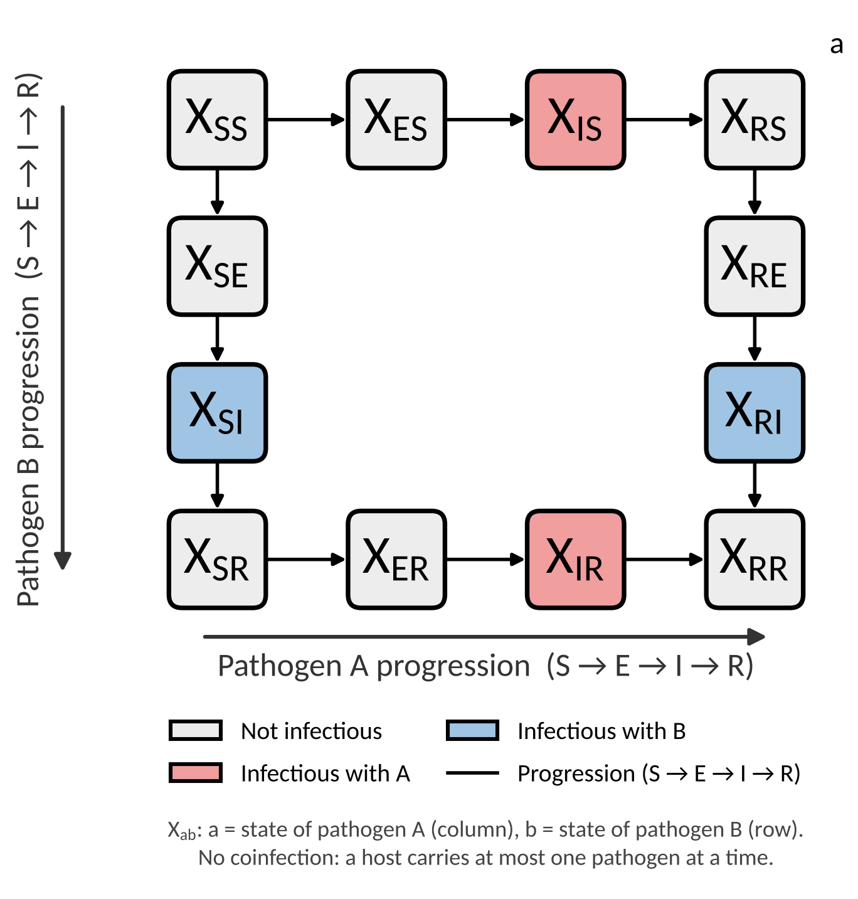
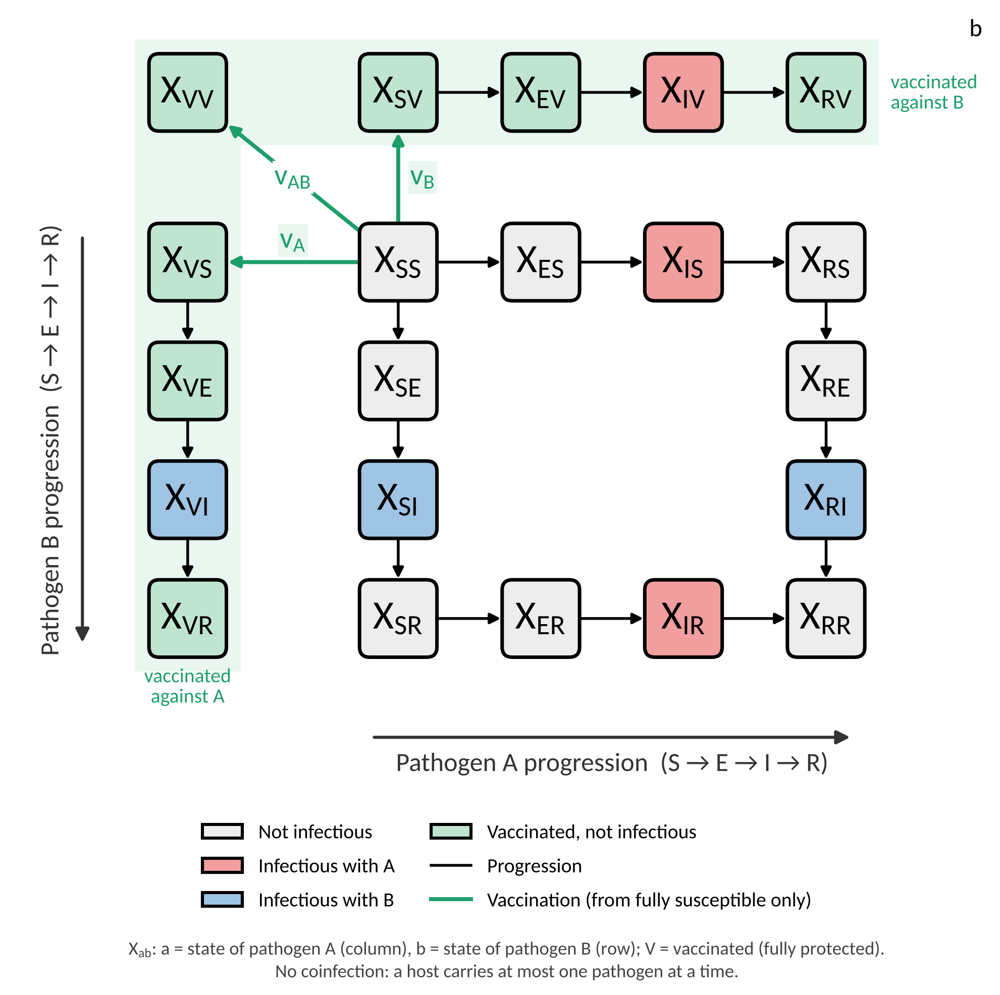

# Interference and Vaccination in Illinois Project

Authors: Alyssa Anastasi, Ria Cheruki, Chloe Yang, Soren Larsen, Ayesha Mahmud, Pamela Martinez

## Project Question & Approach

**Question**: How does interference between two pathogens influence optimal vaccination timing?  

**Approach**: We aim to approach answering this question from a theoretical perspective. If we have two co-occurring pathogens in a population, we can vary their interference which impacts the timing and total disease burden of each of the pathogens. The true interference between two pathogens is unknown but has been estimated in previous literature. Therefore, staying within the bounds of previously estimated and “realistic” interference, we can observe a range of interference parameters. Within this range of interference parameters, we can observe the effect of vaccination in a population as well as the effect of an ongoing vaccination campaign. 

## Methods

### Two-Pathogen Model Structure

### Two-Pathogen Model Structure with Vaccination

